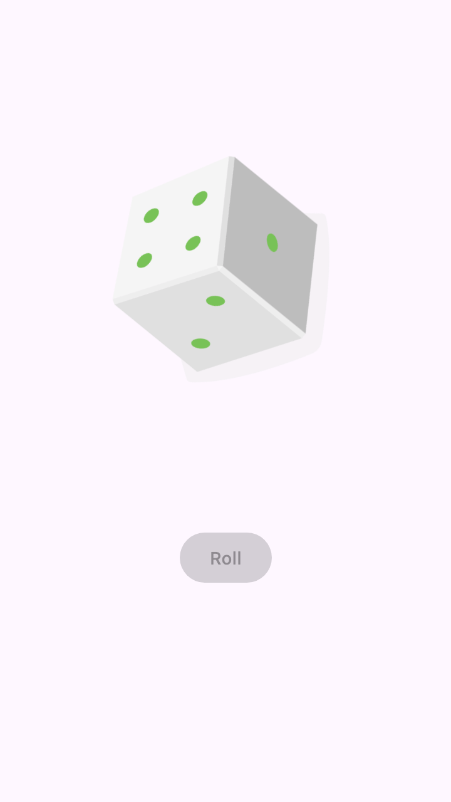
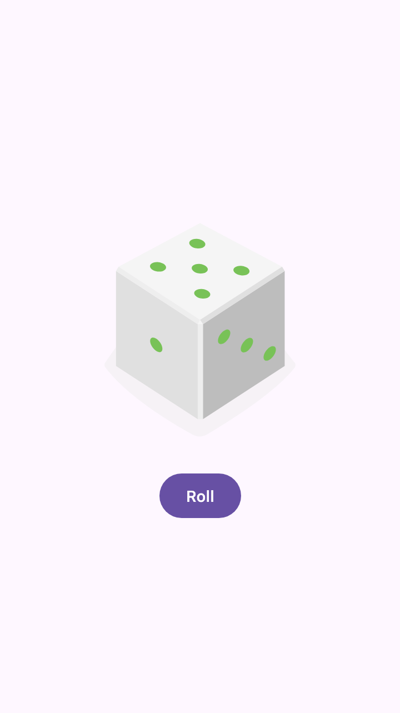

# Dice Roller

A small dice-rolling app built with [Compose Multiplatform](https://www.jetbrains.com/compose-multiplatform/).
Tap **Roll** and the die tumbles, flicks through faces and lands on a random number from 1 to 6.

<p align="center">
  
  &nbsp;&nbsp;
  
</p>

One shared Kotlin codebase runs on:

| Platform | Status |
| --- | --- |
| Android (7.0+, API 24) | Builds and runs |
| Desktop (macOS, Windows, Linux) | Builds and runs |
| Web (Kotlin/Wasm) | Builds and runs in modern browsers |
| iOS | Shared code compiles; needs an Xcode project to run (see [iOS](#ios)) |

## Requirements

- **JDK 17 or newer** (developed with JDK 21)
- **Android SDK** with platform 35 and build-tools 35.0.0, needed for the Android target
- **Xcode** (macOS only), needed for the iOS target

On macOS with Homebrew:

```bash
brew install openjdk@21
brew install --cask android-commandlinetools
sdkmanager "platforms;android-35" "build-tools;35.0.0" "platform-tools"
```

Then point Gradle at them:

```bash
export JAVA_HOME=/opt/homebrew/opt/openjdk@21
echo "sdk.dir=/opt/homebrew/share/android-commandlinetools" > local.properties
```

Android Studio users can skip this: opening the project creates `local.properties` automatically.

## Running

| Target | Command |
| --- | --- |
| Desktop | `./gradlew :composeApp:run` |
| Web (dev server, opens browser) | `./gradlew :composeApp:wasmJsBrowserDevelopmentRun` |
| Android (device or emulator connected) | `./gradlew :composeApp:installDebug` |

## Building

| Output | Command | Location |
| --- | --- | --- |
| Android debug APK | `./gradlew :composeApp:assembleDebug` | `composeApp/build/outputs/apk/debug/` |
| Desktop installer for the current OS | `./gradlew :composeApp:packageDistributionForCurrentOS` | `composeApp/build/compose/binaries/` |
| Static web bundle | `./gradlew :composeApp:wasmJsBrowserDistribution` | `composeApp/build/dist/wasmJs/productionExecutable/` |

The web bundle is static files; serve it from any web server that sends `.wasm` files as `application/wasm`.

## Testing

The dice logic is tested in shared code and runs on every platform:

```bash
./gradlew :composeApp:desktopTest :composeApp:testDebugUnitTest :composeApp:wasmJsTest
```

## Screenshots

The images above are rendered offscreen from the shared UI, not captured by hand. Regenerate them after UI changes with:

```bash
./gradlew :composeApp:readmeScreenshots
```

This writes `docs/images/rolling.png` and `docs/images/rolled.png`. The landed face is random, so it changes each run.

## iOS

The Kotlin side is ready: `MainViewController()` in `iosMain` returns a `UIViewController` hosting the app.
To run it you need an Xcode project that embeds the `ComposeApp` framework. The simplest route is to generate a
fresh project with the [Kotlin Multiplatform wizard](https://kmp.jetbrains.com/), copy its `iosApp/` folder here,
and call `MainViewControllerKt.MainViewController()` from its SwiftUI view.

## Project structure

```
composeApp/src/
├── commonMain/
│   ├── kotlin/…/App.kt          UI and roll animation (shared by all platforms)
│   ├── kotlin/…/Dice.kt         Dice roll logic
│   └── composeResources/        Dice vector images and strings
├── commonTest/                  Shared unit tests
├── desktopTest/                 README screenshot generator
├── androidMain/                 MainActivity, manifest, launcher icons
├── desktopMain/                 Desktop window entry point
├── wasmJsMain/                  Browser entry point and index.html
└── iosMain/                     iOS view controller entry point
gradle/libs.versions.toml        Dependency and plugin versions
```

Tweak the roll animation's length with `ROLL_DURATION_MS` in `App.kt`.

## Tech stack

Kotlin 2.2 · Compose Multiplatform 1.8 · Material 3 · Gradle 8.14 · Android Gradle Plugin 8.10

Dice artwork © The Android Open Source Project, licensed under Apache 2.0.
